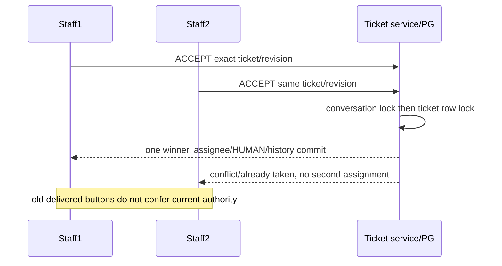
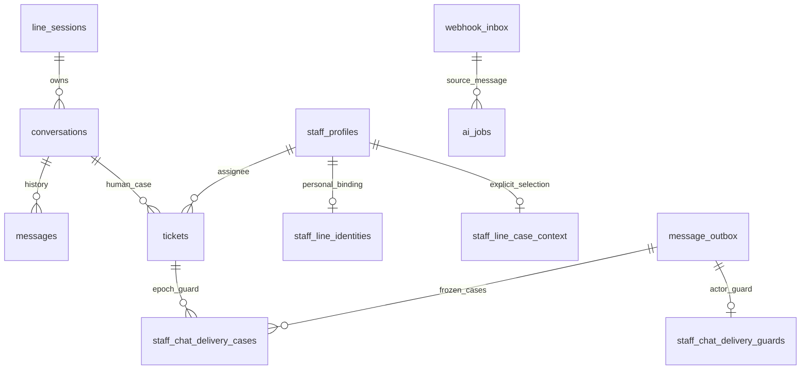
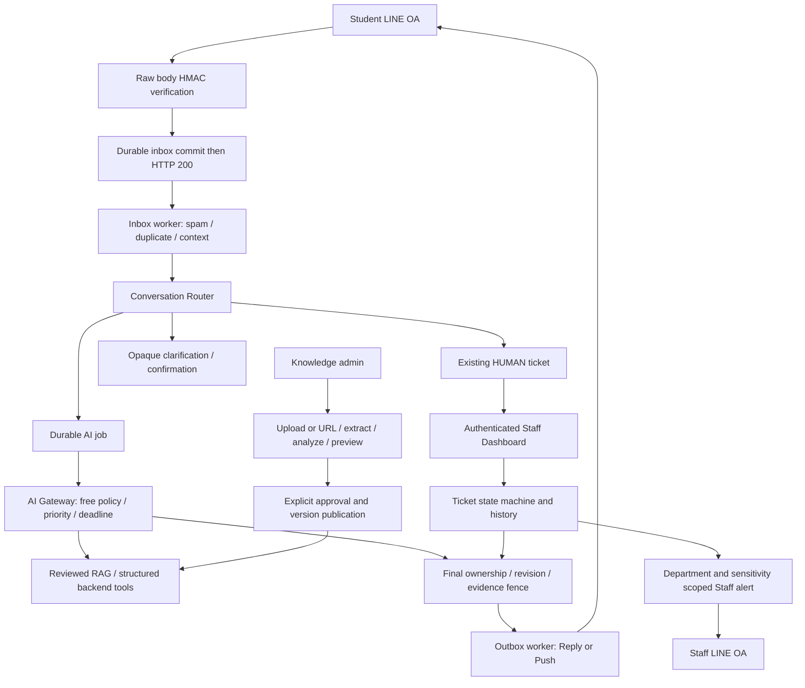
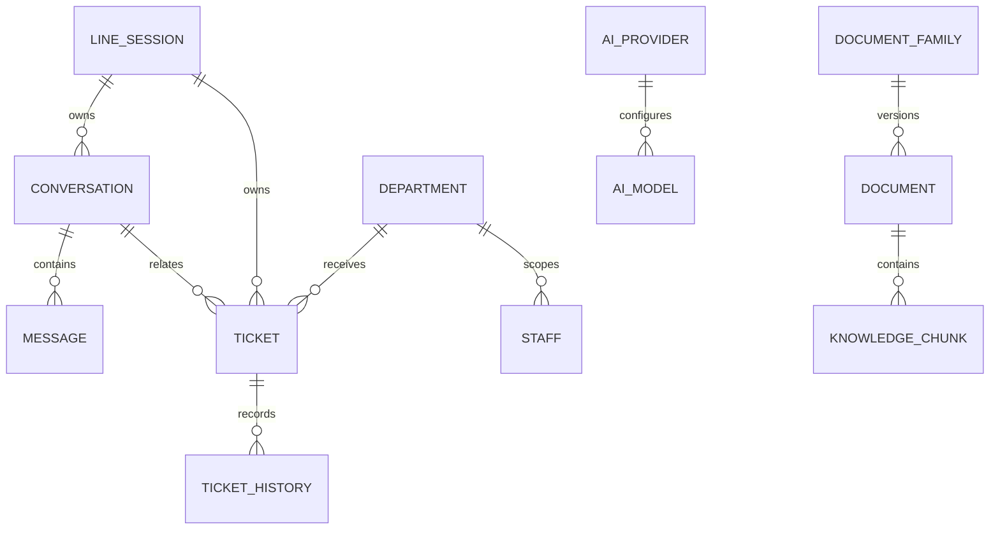
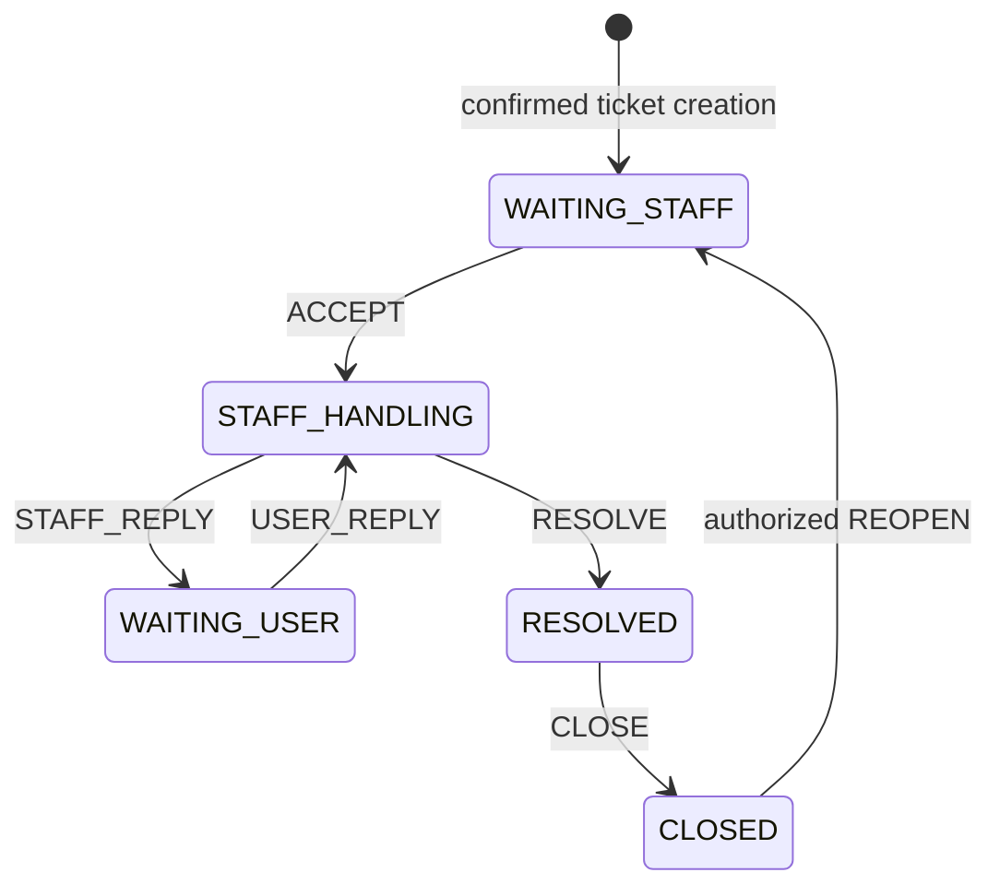

19 October 2026 20:35 Bangkok — SOL02AF isolated QA contract COMPONENT_PASS, current06da17ca…/851paths: exactly2newQA/testfiles, all849previoussourcehashes unchanged. MeaningfulRED29 and reviewRED12 precede final62candidate regressions/focused143 and currenttype/full lint/2890unit219filesPASS. Actual Luna-max finalreview accepts only isolated/non-executable scope; production year behavior remains unchanged. Appbuild399, registeredPG629/browser28/controlledA–J+9loadrounds are retained only by exact unchanged actualinput proof, not newQA-path coverage. Freshcanonical7services/fourcheck-ins/HMAC8PASS; currentHermesNOT_RUNafter429. SOL04K observes freshOpenRouteraccount50/50 andFREE/JSON_OBJECT but firstactualGemmaA09request429/865ms; stopsone/noSecondTurn/noB06orA17/noqualitycredit/noregistration. No Gemini/Zen retry or provider/key/order/enable/cost/grant/corpus/schema change. Primary/fallback, actualperiod/relevance/current30/repeats/activation/liveA–F remain required. NaturalassistantOFF; V1NOT_COMPLETE. All dirty work/failed artifacts preserved; no reset/clean/stash/HEADrestore/commit/push. [AF evidence](../reports/SOL02AF_PERIOD_CANDIDATE_2026-10-19.md) / [K diagnostic](../reports/SOL04K_FREE_QUOTA_GEMMA_2026-10-19.md). Earlier dated entries below are historical.

19October13:06Bangkok — exactW8f0/849 unchanged. Current SOL-06M/07M browser9+19 and controlled A–J/nine10–100–500student rounds PASS; original capacityPARTIAL retained,19fault synthesis uses separate currentPG629 tests. Fresh canonical7services/fourcheck-ins/Hermes2/local+publicHMAC8PASS, latest temporary URLs in final checklist. AD action/prose split stops first semantic failure, sevenNOT_RUN/no promotion. Primary/fallback, year/context/relevance/current30/repeats/guardedactivation/actualFlowA–F remain open; naturalOFF, V1NOT_COMPLETE. All dirty work preserved, no reset/clean/HEAD restore/commit/push or normal model/corpus writes. [Current release evidence](../reports/SOL06M_CURRENT_RELEASE_2026-10-19.md). Earlier dated entries below are historical.

19October12:48Bangkok — current exactW8f0bf328/849; V1 NOT_COMPLETE, natural assistantOFF, primary/fallback NOT_QUALIFIED. W bounded mandatory-field safety component has type/full lint/2818unit/218files/build399/full registered ownedPG629/39processes/43migrations/exact cleanup evidence; all849 hashes restored and verified after Y experiment. Y finalRED1/114 candidate is preserved/unpromoted, no HEAD/reset/clean. X/Z/AA Gemini and AB Groq20BHIGH fail bounded semantic gates; stop rules honored, no parameter/key/order/enable/grant/cost promotion. AC period-proposal first bracket5correct/6run then schemafailure, R2stopsfirstschemafailure; identical-request diagnostic variability is not a repair/pass. Year-validation and hinted-answer relevance gaps remain agent work. Fresh canonical7services/four check-ins/Hermes2/local+public HMAC8PASS on W, latest URLs in final checklist. Current original30/repeats/qualified fallback/current load/browser scopes/guarded activation/actualFlowA–F remain required. No paid calls/normal model or corpus writes. All failed attempts/source/review provenance retained; human configuration/manual tests deferred, never counted as pass. [Current evidence](../reports/SOL_CURRENT_2026-10-19.md).

19October12:36Bangkok — current exactW8f0bf328/849; Y lexical year candidate NOT_ACCEPTED/preserved, all original dirty W hashes restored. Existing exact-source type/full lint/2818unit/218files/build399/registeredPG629/39processes/43migrations/exact cleanup PASS. X/Z/AA Gemini reasoning/instruction experiments and AB Groq20B HIGH remain unqualified; AA stops after first8responses, AB after first B06semantic failure, no extra candidate calls/promotion. AC semantic period proposal diagnostic RUNNING, same planner call/strict literal+scope validation/no actual retrieval/no production change; year gap still open. Fresh canonical7services/four worker check-ins/Hermes2/local+public HMAC8 PASS, current URL in final setup checklist. Natural assistantOFF; no qualified primary/fallback; V1 NOT_COMPLETE. Actual independent Luna-high X/Z/AA review; unavailable architecture review disclosed. Every failed attempt/source retained, no reset/clean/HEAD restart or normal model/corpus writes.

19October12:19Bangkok — SOL-02Y NOT_ACCEPTED / UNPROMOTED. Final candidate RED1/114 reveals conditional-prefix ambiguity after earlier focused201/5; candidate code/tests/evidence preserved by hash. Two exact pre-experiment dirty W files restored without Git reset/clean/HEAD source; all849 hashes and8f0bf328 fingerprint independently match the passed W source. No Y test or V1 criterion waived, original negated-year backend gap remains pending. Exact W technical2818unit/218files/build399/registeredPG629/43migrations evidence retained by full hash identity, not credited to Y. X LOW diagnostic12HTTP200 improves task choice but repeats credential prerequisite failure; no promotion. Z medium controlHTTP200 and bounded six-decision diagnostic RUNNING on immutable W. Canonical runtime authenticated-stopped, all older URLs historical until fresh startup/proof. Primary/fallback NOT_QUALIFIED, natural assistantOFF, V1 NOT_COMPLETE. Human setup remains collected in FINAL_SETUP_CHECKLIST.

19October12:12Bangkok — SOL-02Y IN_PROGRESS source1874f97c…/849. Actual negated-old/exclusive-new year failure reproduced RED14/95 before private temporal resolver; focused196/5 and typecheck PASS. Current full lint/unit/build/registeredPG/review/runtime remain pending after this change. No scope/model/schema/budget/fixture/evaluator weakening; raw question/history/hint/embedding and model inputs preserved, exact target scope and structured-year equality required. W8f0 technical2818unit/629PG/build399/runtime7/Hermes2/HMAC8 PASS is historical for this source. X bounded12HTTP200 comparison on W shows LOW improves A09/A17 task choice but repeats missing credential prerequisite; no parameter promotion or model qualification. Natural assistantOFF, primary/fallback NOT_QUALIFIED, V1 NOT_COMPLETE. All dirty work/failed attempts retained; manual setup stays in FINAL_SETUP_CHECKLIST.

19October12:03Bangkok — SOL-02W TECHNICAL_COMPONENT_PASS current8f0bf328…/849. Captured mandatory personal-field claim RED6, multiline RED7 and diagnostic-overblocking RED3 precede correction; focused183/6PASS. Explicit list-only screening and original-question context preserve general software/phone diagnostics while guarding form requirements; no extra model call/schema/budget change. Final unchanged8f0 source: type/full lint,2818unit/218files, isolated production build399paths and full registered ownedPG629/39processes/43migrations/exact marker cleanup PASS. Actual Luna max read-only review verifies all849 hashes; residual lexical/current-question limits remain. V375e6250 technical component PASS but paired actual-hint relevance NOT_QUALIFIED (transfer two-year regression, year override both fail,429blocked/self-contained and unattempted assistant-only). U/a157 original28/30+18/20 is historical;3representative rounds5/7,5/7,4/7 and R3A10authority blocker remain qualification failures. No primary/fallback qualification or activation; natural assistant OFF; V1 NOT_COMPLETE. After earlier429, one bounded diagnostic LOW reasoning control now HTTP200/strict JSON PASS; this is protocol only, no quality pass or production parameter change. First runtime restart failed worker readiness: diagnostic SET SESSION left one pooled backend read-only (25006). Exact observed session default restored without row/schema/role/database-default change; subsequent unmodified canonical7services/four check-ins/Hermes2/current local+public HMAC8 PASS. Fresh URL in final checklist. SOL-02X DEFAULT/LOW bounded comparison RUNNING, no promotion. Prior failures and two preload-diagnostic harness startup errors are preserved. No account rotation/paid calls or normal model/corpus writes. See SOL02W_REQUIRED_FIELDS and SOL02V_RETRIEVAL_HINT reports; all dirty work and failed attempts preserved.

19 October01:04Bangkok — SOL-02T source74aa63b9…/847: mixed JSON_SCHEMA/JSON_OBJECT compatibility component PASS. RED9/focused172, type/full lint,2741unit/216files, affected ownedPG15/43migrations/exact cleanup and build PASS. Independent Luna high no actionable findings. Actual Gemma4-31B Free JSON_OBJECT request returns429; no answer or quality pass. Read-only account/day quota50/50 available does not establish429cause. Gemini primary choice/order unchanged; no normal model/key/grant writes or paid calls. Previous627PG/load/browser/model27/30+17/20 retain6fb source scope, no current qualification. Fresh7services/Hermes2/local+public HMAC8 PASS on this source. Natural assistantOFF; V1NOT_COMPLETE. Evidence: docs/reports/SOL02T_JSON_OUTPUT_MODES_2026-10-19.md.

19 October00:14Bangkok — SOL-02S source6fb8777c…/846. Original30 FAIL27/30 trajectories,17/20 useful;30/30 authority/ownership safe, zero missing/blocked. A05/A09/A17 remain; A15 summary improved. Type/lint/unit2716/PG627 retain exact unchanged845 non-CSS inputs; CSS-only preview repair has fresh build and browser9+19 PASS/exact cleanup. Current controlled capacity A–J and9load rounds PASS; original PARTIAL retained,19fault combined coverage uses separately named current PG tests (not simultaneous fault-under-load). Fresh launcher7/Hermes2/local+public HMAC8 PASS. Only Gemini3.5FlashLite enabled; no qualified fallback. Natural assistant OFF; V1 NOT_COMPLETE. Root self-review. See docs/reports/SOL02S_CURRENT_2026-10-19.md. Older statuses/URLs below are historical.

18 October14:36Bangkok — SOL-02R current source fc8811f5…/846 paths. Sole enabled generation model Gemini3.5FlashLite remains FREE_ONLY; no provider/key/order/grant changes. Original SOL-02Q interrupted at A15 migration,14 reports only; separately reviewed tail16 is diagnostic and not pooled. Compact decision policy rejected after A17 failure and503-blocked B06; production decision unchanged. Generic partial-evidence RAG summary instruction promoted only after actual A15 RED, two successful A15 diagnostic repetitions and A14 nonregression; focused96tests/2files PASS. Fresh original30 sol02r-main RUNNING, all broader current-source gates pending. Earlier f495 technical passes are historical until revalidated for this change. Natural assistant OFF; no qualified primary/fallback; V1 NOT_COMPLETE. See docs/reports/SOL02R_MODEL_DIAGNOSIS_2026-10-18.md. Root review; preserve every dirty file and failed attempt.

17 October 20:27 Bangkok — SOL-06K f495b0e5… / 846 current source paths: PostgreSQL627/39 processes/43 migrations/77 distinct publication-delivery cases, production build399 paths, browser9Free+19broader and exact owned cleanup PASS. Same-source unit2716/215 files and type/lint retained. Seven canonical services READY, Hermes isolated two-turn PASS, local/public Student+Staff signed-empty200 and invalid401 (8 checks) PASS. First E5 startup120s timeout is retained; separate unchanged loader diagnostic completed31.6s, unchanged canonical retry succeeded without raising timeouts. Root proof helper initially had expected-service sorting wrong; corrected both sides to sort, retained all seven required names. Independent Luna high six-file review: no actionable findings. SOL-02Q fresh frozen30 is RUNNING; prior SOL-02P22/30 trajectories,13/20 useful belongs to12229 source. Natural assistant OFF; no qualified primary/fallback; V1 NOT_COMPLETE. Latest evidence: docs/reports/SOL06K_RESTART_RECOVERY_2026-10-17.md. Older entries below are historical.

16 October 22:20 Bangkok — SOL-06K source f495b0e5… / 846 runtime-test-config paths unchanged. Unit 2716/215 files PASS; type/lint and focused disconnect checks recorded. Full PostgreSQL gate FAIL at RAG compatibility (2/16 PASS, 14 FAIL; earlier 77 distinct publication/delivery cases passed). Isolated RAG diagnostic also FAIL8/16; neither is full acceptance. Both new disposable databases cleaned with exact ownership. Build NOT_RUN: host commit memory preflight blocked startup (580075520 bytes free); browser/runtime/HMAC remain pending, previous URLs are historical. Latest quality attempt on preceding12229 source remains22/30 trajectories,13/20 useful,3missing/1BLOCKED. No qualified primary/fallback; natural assistant OFF; V1 NOT_COMPLETE. Root self-review. See SOL06K_CONNECTION_RECOVERY_2026-10-16 report; preserve all dirty work and failed evidence.

16 October 2026 — SOL-04H current metadata-only source12229fc2…: type/full lint/build,2712unit tests,623owned PostgreSQL tests/39processes/43migrations/77distinct publication cases,9Free+19broader+5selected-live browser groups PASS. First PostgreSQL timeout remains recorded; unchanged rerun passed. Actual selected Google METADATA now HTTP200/SUCCESS, generation test200/SUCCESS; neither is model qualification. Old public tunnel failed DNS; fresh canonical launcher7services/Hermes2turns and local/public HMAC8checks now PASS; current URL is in [16October evidence](../reports/SOL_CURRENT_2026-10-16.md). Earlier checkpoints below are historical. Last full frozen30 on preceding430source FAIL8/30trajectories,5/20useful,10BLOCKED; primary/fallback quality remains agent-owned. Natural assistant OFF; V1 NOT_COMPLETE. Root self-review; all uncommitted work preserved.

15October22:13Bangkok — current430a97ab…/844source paths and399build paths reverified; type/full lint,2702unit/214files,623ownedPG/43migrations/77distinct publication cases PASS. Controlled19fault synthesis PASS with original PARTIAL/earlier ACK failure retained. Current browser9Free+19broader+5selectedlive groups PASS. Exact stop9owned processes/cold restart7services, Hermes isolated2turns and fresh local/public Student+Staff HMAC8checks PASS; latest URLs in setup checklist. Frozen30 FAIL8/30trajectories,5/20useful,10BLOCKED; no qualified primary/fallback, natural assistantOFF, V1 NOT_COMPLETE. Failed policy/candidate diagnostics are not promoted or pooled. C free14.35GiB; source/sessions/models/Docker preserved.

# YRU V1 — System design

DEC-126 / SOL-06K: database clients carry a fixed-code error listener while checked out; errors invalidate work, never replay transactions. Outbox connection loss invalidates held authority locks and aborts pending HTTP. No new send starts after loss; ambiguous Reply stays UNKNOWN and Push retries retain the exact key/body. This does not promise cancellation reverses a request already accepted by LINE. Canonical launcher still shuts down if a service truly exits; application connection recovery prevents the reproduced uncaught client error.

15October05:35 current acceptance: 43migrations/74RLS tables installed only on the explicitly guarded DEVELOPMENT target; rollback role/privacy/grant checks PASS, all four normal queues had0actionable jobs and natural assistant remainsOFF. Current owned registered gate623tests and capacity A–J/CPU/RAM/pool quantiles are controlled evidence; capacity fault aggregate and frozen30/model qualification remain incomplete. Four genuine reviewed PUBLIC receipts have default offlineE5 retrieval evidence. Runtime/tunnel/Hermes and actual FlowA–F must be recorded separately; no component result establishes V1 completion.

15October SOL-03C/03D / DEC115: prior AI history is eligible only if its committed SENT time precedes the current USER question creation time, making generation/dispatch digests stable when older replies arrive later. Predictable typed support confirmation requires an actually SENT proposal before immutable inbox received_at, repeated by backend proof. Opaque postbacks retain their existing token authority. Current actor/epoch/scope/revision/publication fences and no-AI-to-HUMAN remain. [Current evidence](../reports/SOL_CURRENT_2026-10-15.md) separates scoped checks from final acceptance.

## SOL-00 current concurrency design, 14 October 2026

[Current-source audit](../reports/SOL00_CURRENT_SOURCE_AUDIT.md) retains hybrid Dashboard-primary + explicitly selected bound personal Staff LINE. No Redis, new session table or CLI production orchestration follows the audit. The diagrams below explain existing boundaries and the explicit SOL-03A acceptance gap; intentions are not test evidence.

```mermaid
sequenceDiagram
  participant L as Student LINE
  participant H as Signed webhook
  participant Q as PostgreSQL inbox
  participant W as Worker/Gateway
  participant O as Guarded outbox
  L->>H: raw signed batch (possibly replayed)
  H->>H: verify raw HMAC then parse
  H->>Q: atomic channel/event-id persist
  Q-->>H: commit
  H-->>L: HTTP200 durable ACK
  W->>Q: lease oldest eligible owner event
  W->>W: model/tool HTTP outside transaction
  W->>O: current owner/revision/evidence finalize
  O->>O: recheck actor/epoch/source/exact recipient
  O->>L: supported reply/push with stable retry identity
  Note over O,L: acceptance is separate from delivery/read; ambiguous reply stays UNKNOWN
```



```mermaid
sequenceDiagram
  participant S as Bound Staff LINE
  participant C as Selection/event sequence
  participant T as Exact T1 ticket/outbox
  participant U as Incoming Student
  S->>C: OPEN T1, UUID/epoch/binding/absolute TTL
  S->>T: text to T1 after current selection check
  S->>C: OPEN T2 (newer source sequence)
  U->>T: T1 USER history and scoped notice
  Note over C,T: notification does not select T1; queued T1 reply cannot become T2
  T->>T: dispatch current actor/epoch and captured original TTL
  Note over T: captured TTL dispatch is SOL-03A gap to reproduce/repair
```

```mermaid
sequenceDiagram
  participant A as AI worker
  participant S as Staff takeover
  participant P as PG conversation/lease
  A->>P: AI snapshot/revision
  A->>A: inference outside SQL
  S->>P: ACCEPT, HUMAN + revision + suppress AI outbox
  A->>P: finalize old result
  P-->>A: stale/HUMAN rejected
  Note over P: dispatch also rechecks; no AI reply inside that HUMAN case
```



Actual ticket state transitions remain `WAITING_STAFF -> STAFF_HANDLING` on ACCEPT; STAFF_REPLY enters/stays WAITING_USER; USER_REPLY returns STAFF_HANDLING; explicit RESOLVE -> RESOLVED -> CLOSE -> CLOSED; scoped REOPEN -> WAITING_STAFF. NEW/AI_HANDLING/CANCELLED enum members do not grant arbitrary transitions. Queue claims use owner FIFO/SKIP LOCKED/leases (inbox30s, AI90s, outbox60s), bounded attempts and durable result/attempt records. SQL transactions are short; dispatch retains sorted catalog/access/conversation/delivery session locks across bounded LINE HTTP. Crash before persistence yields non-2xx; replay after commit yields one logical effect; ambiguous reply remains UNKNOWN, push reuses its original retry key. No user profile, model SQL, automatic publication/close or system-event selection renewal is introduced. Capacity/held-lock fairness and final source/recipient/security gates require owned current-source evidence.

10October21:15 AI-AGENT-01 planning supersedes fixed conversational behavior under DEC-103: a bounded model-directed assistant selects natural general reply, needed clarification, authorized evidence tools or handoff proposal, while backend retains source/action/ownership/HUMAN checks. Root live diagnosis and [support design](AI_SUPPORT_WORKFLOW_DESIGN.md)/[execution plan](../superpowers/plans/2026-10-08-yru-support-workflow.md) reopen conversational quality;41schema/Staff batch acceptance does not establish usable AI conversation. No runtime change follows this planning-only checkpoint.

**Current acceptance,10October20:52 Bangkok:** Staff OA explicit case chat, Dashboard-primary case separation and immutable reviewed selected-case common replies/results/retry/late-case proposal are implemented. Durable Staff sources coalesce before transport for a finite configurable0..300seconds (default30), release individually if detection is unavailable, and notify current critical episodes immediately. Locked current access/frozen-case/provenance guards precede enqueue, priority bypass and outside-SQL delivery; no automatic claim/read/resolution/chat switch. Root49/49 focused Staff-alert ownedPG are included in565/565 registered actual PostgreSQL cases across33groups;41migration replay/RLS/least grants/advisors0ERROR0WARN112INFO/exact owned cleanup PASS. Final root typecheck/full lint/2323unit in185files/full-current-source isolated production build PASS after the native-fetch settings regression fix. Compiled actual scoped browser acceptance passes6settings+7batch groups at1440/390/320, including CAS/role boundaries, lost committed responses/reload, stable failed-only retry and explicit late-case-only send. LINE is controlled in these acceptance tests, not live OA. LOCAL+selected DEVELOPMENT now41versions/72RLS. Guarded activation preserved exact row counts and hashes for all69 preexisting public/private tables (excluding only the three additive columns); default Staff wait30seconds and least service grants verified. One coordinator restarted READY with offline CPU E5/384, web/four fresh workers and signed local/public200 plus invalid-signature401. Current HTTPS domain native-lobby-replies-turner.trycloudflare.com; .env and FREE_ONLY unchanged, web search off. Approved PUBLIC corpus0, current real free-provider429/timeouts, real multi-session/two-Staff OA/FlowA–F and production deployment/restore remain MANUAL_PENDING. No whole-V1/live pass, new report, staging, commit or push. See [incident design](INCIDENTS_DESIGN.md) and current board; older dated remaining-work statements below are historical.

9 October LOCAL-TEST-01 operational supplement: [one-command local session](../operations/LOCAL_TEST.md) launches existing offline E5/web/four workers/quick HTTPS tunnel against guarded DEVELOPMENT. Durable/AI/public APP_BASE_URL are temporary child flags under the human's explicit local-test request; `.env`, source approval, schema, FREE_ONLY and web-search-disabled defaults remain preserved. [Executed launcher report](../reports/LOCAL_TEST_RUNNER_REPORT.md) separates startup/transport/E5/process evidence from actual inference/source/OA A–F acceptance.

9 October current implementation: [C3D procedural/general cascade](PROCEDURAL_WEB_CASCADE_DESIGN.md) and controlled A–F are automated-accepted in the [final report](../reports/V1_AUTOMATED_ACCEPTANCE_REPORT.md): 389/25 registered cases including A–F 8/8, 38 replay/RLS/advisors/cleanup, 2,087 unit, compiler/lint/build and browser PASS. [Production runbook](../operations/PRODUCTION_RUNBOOK.md) defines deployment packaging/lifecycle; actual host and live sources/providers/E5/OA/restore remain MANUAL_PENDING. Local+selected DEVELOPMENT stay38versions/59RLS; no schema, credentials, source approval or live settings follow C3D. Remaining-work notes in earlier dated paragraphs are historical.

9October current: [owned web-lead integration](WEB_LEAD_INTEGRATION_DESIGN.md)/[evidence](../reports/WEB_LEAD_INTEGRATION_REPORT.md) is component-accepted through Student worker/dispatch and HUMAN Staff drafts, with fresh complete internal misses and five-minute unverified canonical links. Local+selected DEVELOPMENT38versions/59RLS tables/least grants/catalog readiness/retention verified. Default search/AI configuration remains disabled. Semantic procedural NOT_APPLICABLE/general fallback, final controlled FlowA–F and deferred live corpus/provider/E5/OA/production acceptance remain required root work.

9October current complete-miss contract: [C3B design](INTERNAL_MISS_DESIGN.md)/[evidence](../reports/INTERNAL_MISS_REPORT.md) passes349ownedPG/38replay/RLS/advisors0ERROR0WARN/2,013unit/type/lint/build. Authenticated explicit Structured/RAG miss is not actor authorization or a production web caller. Complete web/source/delivery/Staff/FlowA–F/live acceptance remain required; normal36 unchanged.

9 October current RAG boundary: [C3A chunk catalog fence](RAG_CATALOG_FENCE_DESIGN.md)/[evidence](../reports/RAG_CATALOG_FENCE_REPORT.md) passes326ownedPG/38replay/RLS/advisors0ERROR0WARN/type/scoped lint. Normal/local+DEVELOPMENT remain36; complete miss/web/delivery/Staff and final combined/live acceptance remain required.

9 October current web boundary: [C2-T/R connector/admission](../reports/FREE_WEB_CONNECTOR_REPORT.md) provides a default-disabled free-search runtime and retained private quota ledger, with owned37 replay and complete component gates. No Student/Staff production caller or live search is enabled; local+DEVELOPMENT stay36. Complete internal misses/chunk writer fence, official proof/leads, delivery/Staff integration and final combined/live acceptance remain root work.

เอกสารรวม architecture วันที่ 4 ตุลาคม 2026 ใช้กับ [master guide](../../CODEX_IMPLEMENTATION_GUIDE_YRU_AI_HELPDESK.md), [ต้นฉบับ](../requirements/sources/README.md), [matrix](../requirements/V1_REQUIREMENTS_MATRIX.md) และ [task board](../tasks/V1_TASK_BOARD.md). แยก **มี implementation/evidence** ออกจาก **planned** ไม่ถือว่า diagram คือสิ่งที่ทำเสร็จทั้งหมด

9October current source contract: [source cascade](SOURCE_CASCADE_DESIGN.md) closes only the internal Structured EMPTY→reviewed RAG ordering and its higher-tier freshness proof. Official/general web remains root implementation. Current [board](../tasks/V1_TASK_BOARD.md) and linked dated reports supersede older planned-status examples below; deployment/live corpus/provider/OA/combined FlowA–F remain separate acceptance.

9October current incident contract: [authenticated context](INCIDENT_CONTEXT_DESIGN.md)/[runtime evidence](../reports/INCIDENT_CONTEXT_RUNTIME_REPORT.md) implements source-bound system/location proofs, worker/read freshness and retained-history compatibility. Local+DEVELOPMENT36versions/58RLS tables/exact grants/retention are verified. Live corpus/E5/operator and combined flows remain separate; [C2-Q](../reports/PUBLIC_SEARCH_QUERY_PREPARATION_REPORT.md) is unused public-query preparation only.

## System boundaries

5 October human update: default embeddings are local CPU `intfloat/multilingual-e5-small` / 384, through private FastAPI called only by Next.js backend. [Embedding design](EMBEDDING_SERVICE_DESIGN.md) owns cache/offline/prefix/configuration/typed-vector contracts. Normal Provider UI configures generation/reasoning; embedding health is read-only. Historical external adapters are compatibility code. Generation remains FREE_ONLY; foundation/import/publication/full-flow acceptance stays explicit.

Student OA เป็นช่องทางถาม/ตอบ anonymous; Staff OA เดิมเป็น alert/bind/action/เปิด Dashboard. คำขอล่าสุด10Octoberเพิ่ม manual case chat ผ่าน Staff OA → backend → Student OA และ incident shared replies ตาม [Staff extension](STAFF_LINE_BINDING_DESIGN.md)/[Incident extension](INCIDENTS_DESIGN.md), DEC-081/099–102; ส่วนขยายผ่าน automated component acceptance แล้ว แต่ LINE OA หลายผู้แจ้ง/เจ้าหน้าที่จริงยัง MANUAL_PENDING. ทั้งสองฝ่ายไม่ต้อง add LINE ส่วนตัวกัน. Staff Dashboard ใช้ Supabase Auth; backend ตรวจ department/sensitivity/active role ก่อนอ่านหรือเปลี่ยนงาน. Supabase PostgreSQL/Auth/pgvector เป็น data layer; Storage/import acquisition เพิ่มใน M7. Gateway คุม runtime generation ตาม FREE_ONLY และ priority; embeddingsใช้local E5 infrastructure. University เพิ่ม paid generation option ผ่าน UI ภายหลัง



Diagram summarizes runtime boundaries with component evidence for ingestion/queues/tickets, free generation adapters/Provider UX, all-format import/structured publication, Staff binding/assistance and authenticated source-bound incident detection. Official/general web and final combined/live acceptance remain tracked in the current board. AI has no unrestricted SQL/search/publication authority.

## Anonymous identity และ persistence

LINE technical identity encrypted/private server boundary; browser/UI เห็น anonymous code. Studentไม่มี login/student profile; Staff identity เป็น Auth subject → active staff/permissions. Message/conversation/ticket มี ownership และ revision แยกกัน; new topic ไม่ถูกดูดเข้าตั๋วที่กำลัง HUMAN

Logical relationships ด้านล่างย่อจาก schema ปัจจุบัน ไม่ใช่ ER diagram ของทุก physical constraint:



Actual SQL source อยู่ใน `supabase/migrations/`; ตัวอย่างชื่อตาราง/ไฟล์ในคู่มือไม่บังคับให้ duplicate schema เมื่อ behavior มี implementation เดิม เช่น ticket messages ผ่าน `messages.ticket_id`, versions ผ่าน documents/version_stream. Mapping ต้องมี acceptance ไม่ลบ requirement เพื่อให้ชื่อเข้ากัน

## Conversation และ ticket state

8October RAG-01A [semantic context design](AI_CONTEXT_ROUTING_DESIGN.md)/[component evidence](../reports/SEMANTIC_CONTEXT_ROUTING_REPORT.md) binds the configured free gateway in the production inbox worker. Ephemeral labels and actual USER snapshots commit before HTTP; bounded proposals map only after fresh lease/context checks. Unknown/low-confidence/stale results retain explicit owned choices. Business intent/troubleshooting and full sourced/live FlowE remain separate acceptance.

Router outcome: existing context, new AI conversation, context question หรือ blocked/spam. Context choice ใช้ opaque signed/owned/expiring tokens; ticket creation ต้อง confirmation backend-owned. AI classification เป็น structured proposal ที่ตรวจ against user text/applicability/active departments; ไม่ใช้ keyword เป็น final router

State machine มี implementation ใน `lib/conversation/state-machine.ts`:



Schema ยังมี NEW/AI_HANDLING/CANCELLED แต่ service ไม่อนุญาต arbitrary transition. ACCEPT ตั้ง HUMAN; AI job/result/outbox ต้องตรวจ ownership/mode/revision อีกครั้งก่อนส่ง; เฉพาะ conversation ของ ticket นั้นถูกยับยั้ง new AI topic ยังคุยได้. เจ้าหน้าที่เป็นผู้ resolve/close; late reply ใช้ queued push ผ่าน Student OA และมี audit/idempotency

## Durable boundaries และ race handling

- Webhook อ่าน raw bytes ตรวจ HMAC ก่อน JSON; valid empty events ตอบ 200. Durable path commit inbox ก่อน ACK; ไม่มี model call ใน webhook transaction
- Inbox/outbox/AI jobs ใช้ leases/order/retry/idempotency; classify unsupported events โดยไม่สร้าง Student identity จาก Staff OA
- AI worker snapshot ใน short transaction → generation/embedding/search HTTP นอก transaction → stored result → reauthorize/revision/evidence checks → atomic message/outbox/job finalization. Retry ที่มี saved result ไม่ regenerate
- LINE dispatch revalidates HUMAN/revision และ eligible citations. Publication ใช้ sorted family locks ก่อน document locks ก่อน row locks; delivery ใช้ matching session/family/document fence ตาม M6 plan/report. ห้ามข้าม fence เมื่อ M7 เพิ่ม version/amendment
- Runtime tools have allowlisted parameters/owned confirmation/atomic receipts. Seven installed datasets use authenticated exact queries/provenance and repeated source fences. Scoped semantic similarity and authenticated system/location context are implemented; bounded external web and final combined/live acceptance remain pending.

## AI Provider

Contract รายละเอียดอยู่ใน [AI provider design](AI_PROVIDER_DESIGN.md). Default FREE_ONLY ครอบคลุม generation/test และ deterministic bounded fallback; embeddingsใช้local E5 infrastructure. Provider/Model ordering, HTTP observation, quota scope และ selected-model probe เป็น requirement ของ generation UI ไม่ลดเหลือ server priority field/one health badge

PRV-01…05 automated prerequisiteผ่าน [provider acceptance](../reports/PRV_COMPATIBLE_ACCEPTANCE_REPORT.md): verified free Zen/OpenRouter/order/status/probes/cooldown/compatible configuration. Live free quality/account evidenceยังpending; M7เดินต่อหลัง gatesจริง ไม่เปลี่ยนลำดับmasterเพื่อเลี่ยงgap

## RAG และ versioned knowledge

Metadata scope: PUBLIC/reviewed/approved, official source, current/effective, family/year/audience/student type, authority, department แล้วจึง similarity/freshness. Historical question ระบุปี/date ที่มาจาก user; ambiguity ให้ถามกลับ ไม่ปล่อย LLM เดา current academic year/cohort

Chunks มี document/page/section/source provenance; citations สร้างจาก IDs ที่ retrieval ส่งจริงไม่รับ URL/title/page ที่ model แต่ง. Embedding cohort แยก fingerprint/dimension/provider/model configuration ไม่ผสมเวกเตอร์ข้ามรุ่น. Exact prefiltered distance ใช้กับ shortlist; ANN ยังต้องเลือก cohort/วัด recall

Document family/version streams preserve current uniqueness and history. Current replacement marks the old version SUPERSEDED without deletion; supplemental instruments never replace the base. Accepted relationship retrieval resolves complete base/amendment/cancellation groups before similarity, with reviewed publication/approval/catalog UI and delivery fences. See [relationship evidence](../reports/IMP_RELATIONSHIP_RETRIEVAL_REPORT.md); real university corpus approval remains separate.

## Import และ fixed structured data — component evidence

Target: PDF/DOCX/XLSX/CSV/URL → private original/checksum → bounded extraction → quality/sensitivity flags → family/department/date/authority/classification proposal → editable version-conflict preview → explicit approval → atomic version/chunks/dataset publication

The private all-five-format import/review/catalog and atomic RAG/STRUCTURED/BOTH components are accepted at their dated checkpoints. RAG persists prepared chunks/vectors, STRUCTURED persists authenticated typed rows without embeddings, BOTH persists both atomically with the same immutable receipt/version/relationship effects. Review3 preserves source mapping and deliberate approval. [Atomic evidence](../reports/STRUCTURED_ATOMIC_PUBLICATION_REPORT.md), [search/delivery](../reports/STRUCTURED_SEARCH_DELIVERY_REPORT.md), [combined UI](../reports/V1_COMBINED_UI_REPORT.md). Actual PDF400/409 recovery retains original bytes/located text/rows and unresolved warnings; [recovery](../reports/IMP_PDF_RECOVERY_REPORT.md). Local+DEVELOPMENT now36versions/58RLS application tables, seven runtime-ready datasets; no real university source was approved automatically. Final combined calendar/current/history/import flow and live corpus acceptance remain pending.

แผน M7 เดิมเริ่ม PDF/HTML slice; **ไม่ครบ V1 file types** จึงมี IMP-02 ต่อ DOCX/XLSX/CSV และ tests. Storage/encryption/access/retention ต้องมี plan ก่อน implementation ไม่อ้างว่ามี Supabase bucket พร้อมแล้ว. Low-quality/OCR/cohort/source warnings อยู่ PENDING_REVIEW จนคนตรวจ ไม่มี publish อัตโนมัติ

M8 registry จำกัด 7 datasets: `academic_calendar_events`, `tuition_fees`, `transfer_courses`, `university_services`, `university_systems`, `service_forms`, `announcements`. Exact dates/fees ใช้ validated structured query และ citation/version. Unknown dataset → RAG proposal/manual schema change ภายหลัง ไม่ AI DDL และไม่มีตารางรายปี

## Advanced และ operations — component evidence / remaining integration

Staff alerts target active/bound/authorized staff in the exact department/sensitivity scope. Self binding, HUMAN manual AI drafts/internal cited knowledge, scoped incidents/operational reads/metrics/UI, loading transport and private worker observation components have dated acceptance in the board. Observed timestamps never imply process health; unknown remains explicit. Verified system/location context, official/general web and final combined FlowA–F are remaining root implementation/acceptance. Real OA/account/corpus/deployment checks remain deferred human setup.

Staff-only AI assistanceระหว่างHUMANต้องแยกflow: authorizedstaffขอสรุป/แนะนำreply/knowledge/similartickets/route/severity → validatedgateway/tools → draftในDashboard. Studentไม่รับผลจนstaffกดส่งผ่านStaffReplyAPIตามstate machine. Master§52ต้องมีsummary/relatedtickets/knowledgecoverage ไม่ถือว่ามีmessagehistoryแล้วครบ

Dashboard modulesเป้าหมายมี **13**: Overview, Tickets, Incidents, Departments, Knowledge Base, Activities, AI Providers, AI Models, Fallback Rules, Usage, Analytics, Logs, Settings. ไม่จำเป็นต้องเป็น13routesแยก; Providers/Models/Fallbackอยู่surfaceเดียวได้แต่ต้องมีacceptanceของทุกfunction. Overview8metricsในต้นฉบับต้องมาจากจริง: Questions Today, AI Resolved, Human Escalations, Open Tickets, Urgent Tickets, Active Incidents, Common Problems, AI Provider Status. ไม่มีStudentManagement/ตัวเลขfixtureในruntimeUI

Rich Menuในต้นฉบับ§20เป็นข้อเสนอสำหรับprimaryentry (AskAI/MyTickets/Guides/ContactStaff) ไม่แทนcontextQuickReply. เก็บเป็นplannedoption ADV-05; ต้องระบุdecisionก่อนทำหรือdefer ไม่หายจากแผนเพราะไม่มีในchapterอื่น

Deployment ต้องมี web + inbox/outbox/AI/import workers ที่มี lifecycle ชัดเจน ไม่สมมติว่า route บน Vercel จะเป็น continuous worker. Production hosting/domain/backup/storage/observability เป็น final deployment contract ที่ยังไม่เลือก

## การตรวจรับ

Current M7 catalog/assistance contracts: [approved administrative inventory](KNOWLEDGE_CATALOG_DESIGN.md), [private prepared metadata](IMPORT_ASSISTANCE_DESIGN.md), [browser API boundaries](../operations/BACKEND_UI_CONTRACTS.md). Root supplies read-only backend/auth/SQL/revision/retention evidence; Gemini owns separate Dashboard presentation and submits commits for combined acceptance. No migration or normal-provider embedding change is introduced. See [current backend report](../reports/KNOWLEDGE_CATALOG_ASSISTANCE_BACKEND_REPORT.md) rather than treating an API component pass as full UI/usability/V1 evidence.

Unit/property behavior + actual PostgreSQL/RLS/concurrency + signed HTTP + authenticated browser ตรวจ component. Flow A–F ตรวจ business behavior ข้าม subsystem และแยก controlled mock transport จาก live free provider/OA. คำสั่ง/หลักฐานอยู่ใน reports; manual gates อยู่ใน [final setup checklist](../operations/FINAL_SETUP_CHECKLIST.md)

Document checkpoint นี้ไม่ได้รัน application build ใหม่ และไม่ทำให้ pending pricing RED test ผ่าน การปิด milestoneต้องตรวจ source ที่รวมแก้แล้วจริง ไม่เอาจำนวน tests ก่อนแก้มาอ้าง whole completion
